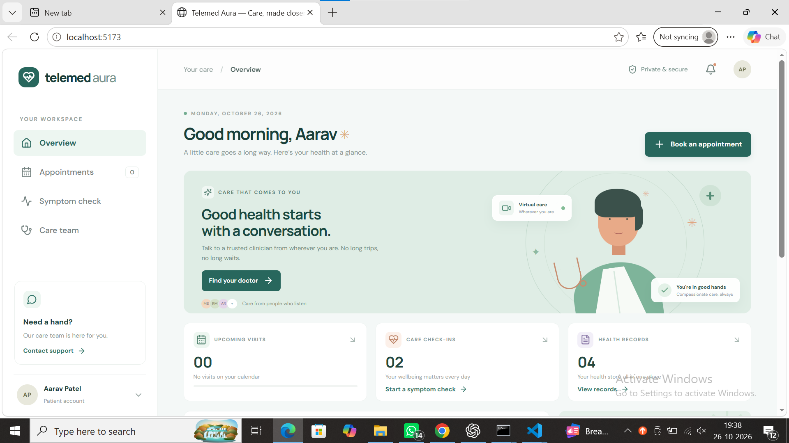

# Telemed Aura

A full-stack telehealth appointment demo with a patient dashboard, clinician listings, appointment booking, and rules-based symptom guidance.

## Features

- Responsive React patient dashboard
- Appointment booking with Express API validation
- SQLite persistence for appointments
- Symptom guidance with emergency symptom messaging
- Vite proxy connecting the frontend to the backend

## Tech stack

React, TypeScript, Vite, Node.js, Express, Zod, SQLite

## Run locally

Start the backend in one terminal:

```bash
cd backend/src
npm.cmd exec -- tsx watch index.ts
